<!-- _class: lead -->
<!-- _paginate: skip # skip the header -->
<!-- _header: "" # skip the footer -->
<!-- _footer: "" # skip the footer -->

<style scoped>
  * {
    background-color: rgba(255, 255, 255, 0.3);
  }
</style>


# Local LLMs

### OSS Meetup

2026-11-10 Timon Erhart

---

## Roadmap

- Ollama (CLI)
- LM Studio (GUI)
- Using API
- Using SDK to create an app
- Using Agent Harnesses (Coding Agent)
- Using an MCP
- Creating an MCP
- Local RAG

---

## Ingredients

Let's cook... 👨‍🍳



---

## Model Zoo

- **Hugging Face:** https://huggingface.co/models

<div style="display: flex; gap: 20px;">
<div style="flex: 1;">

- Qwen (Alibaba)
- Gemma (Google)
- Mistral / Mixtral (Mistral AI)
- DeepSeek

</div>
<div style="flex: 1;">

- Phi (Microsoft)
- GLM (Zhipu AI)
- Llama (Meta)

</div>
</div>

---

## Model categories

- **Text generation:** Your regular LLM Chatbot
- **Decision models:** Make decisions with only 1 output token (fast)
- **Embedding models:** Convert text into a vector representation
- **Text-to-X** / **X-to-Text** models: Convert text into images, audio, video, etc.
- ...

---

## Formats

<style scoped>
table { font-size: 0.75em; }
</style>

- **Safetensors** – raw training weights (vLLM, MLX)
- **GGUF** – one file, quantized (llama.cpp, Ollama, LM Studio)


---

## Quantization

Reducing the precision of the model weights to save memory and speed up inference.

| Precision | 8B model | Quality |
|-----------|----------|---------|
| FP32      | ~32 GB   | Baseline (training precision) |
| BF16      | ~16 GB   | Essentially lossless |
| Q8_0      | ~8.5 GB  | Near-lossless |
| Q4_K_M    | ~5 GB    | Sweet spot for most users |
| Q2_K      | ~3 GB    | Significant degradation |

- **Rule:** Model + context must fit into (V)RAM

---

## Ollama

Ollama is a local LLM runner that provides a CLI and API interface.

- Get started: https://docs.ollama.com/quickstart

---

## API's

Supported API endpoints:

- Ollama API: http://localhost:11434/api
- OpenAI Chat Completions: http://localhost:11434/v1
- OpenAI Responses: https://ollama.com/v1/responses
- Anthropic Messages: http://localhost:11434
- System One (decisions): http://localhost:11434/v1/systemone

We will use the OpenAI Chat Completions in this workshop

---

## Usage 1: Raw API

```sh
curl https://ollama.com/v1/chat/completions \
  # Not needed for local calls
  # -H "Authorization: Bearer $OLLAMA_API_KEY" \
  -H "Content-Type: application/json" \
  -d '{
    "model": "gemma4:31b",
    "messages": [
      {
        "role": "user",
        "content": "Say hello in one sentence."
      }
    ]
  }'
```

Workshop: `workshop/01_api/`

---

## LM Studio

- LM Studio is a local LLM runner that provides a **GUI and API interface**.
- It provide the same features like Ollama, but trough the GUI:

  - Model management
  - Customization
  - Tool usage (MCP)
  - Chat
  - ...

- Like Ollama, several API endpoints are supported.

- (The rather new **Bionic** provides even more features similar do e.g. Claude Desktop: for creativity, work, and code)

---

## Usage 2: Python SDK & Tools

- ⚔️ Choose your weapon:
  - Pythantic AI
  - OpenAI Agents SDK
  - LangGraph
  - Microsoft Agent Framework
  - Vercel AI SDK

- Build an app / abstract the API
- **Tools**: Functions the model can decide to call


Workshop: `workshop/02_sdk/`

---

## Usage 3: Agent Harnesses

- A.k.a. **Coding Agents**
- A harness that allows the model to call tools and functions to interact with the outside world

- ⚔️ Again.. Choose your weapon:
  - OpenCode
  - Pi
  - (Claude Code / Codex / GitHub Copilot)
  - ...

Workshop: `workshop/03_harnesses/`

---

## Using an MCP

- **MCP** (Model Context Protocol) – standard to plug tools into any LLM app
  - https://github.com/modelcontextprotocol
  - think of it as like a **tool** from before, but reusable
  - **Remote** MCP: hosted on a server
  - **Local** MCP: runs on your machine

Workshop: `workshop/04_use_mcp/`

---

## Creating your own MCP

- We will use [FastMCP](https://gofastmcp.com)

Workshop: `workshop/05_create_mcp/`

---

## RAG

- RAG (Retrieval Augmented Generation) is a technique to include relevant external information into the LLM to improve the quality of the generated output.

- Frameworks exists or can used as plugins:
  - LM Studio rag-v1 plugin
  - OpenUI with plugins
  - RAGFlow
  - ...

---

## RAG Pipeline

The simplified pipeline is:

1. Extract content from documents (text, pdf, html, ...)
2. Chunk the documents
3. Create embeddings for each chunk
4. Store the embeddings in a vector store (Chroma, LanceDB, ...)
4. When a user query comes in, create an embedding for the query
5. Retrieve the most relevant chunks by doing a similarity search of the embeddings in the vector store
6. Prompt the LLM including the query and retrieved chunks to generate a response

---

## Create your own RAG

Workshop: `workshop/08_rag/`

---

## Aftermath

Things explicitly not covered, but you should read about if you are not familiar with:

- How does an LLM work (transformer, embeddings, auto-regressive, attention, etc.)
- AGENTS.md and SKILL.md files
- Settings like temperature, top_p
- LLM Security and guardrails
- Prompt engineering

Thinks to explore yourself:

- Install and use **Open WebUI**
- The full capabilities of agent SDK's (e.g. guardrails, subagents, ...)
- Build simple frontends and Apps using Streamlit or Gradio